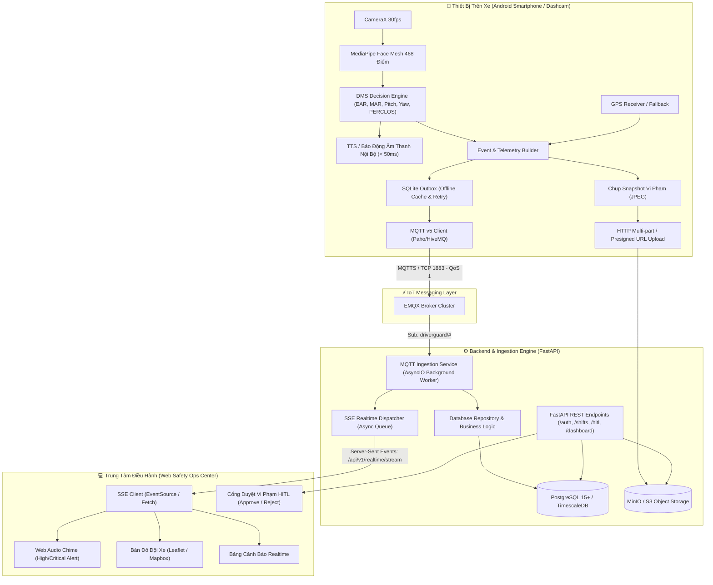

# 🏛️ SYSTEM BLUEPRINT MASTER: DRIVERGUARD DMS & FLEET SAFETY PLATFORM
> **Hệ thống Giám sát Tài xế Bằng Thị giác Máy tính Biên (Edge AI DMS) & Trung tâm Quản trị An toàn Đội xe (Fleet Safety Core IoT)**  
> *Đặc tả chi tiết để vibe-code dự án đạt 99% mức độ tương đồng và sẵn sàng production.*

---

## 1. TỔNG QUAN HỆ THỐNG & KIẾN TRÚC TOÀN CẢNH (HIGH-LEVEL ARCHITECTURE)

Hệ thống DriverGuard được thiết kế theo mô hình **Hybrid Edge-Cloud IoT**:
- **Tại biên (Edge - Mobile Android Device trên xe)**: Chạy thị giác máy tính trực tiếp bằng GPU/NPU qua MediaPipe Face Mesh (không gửi video stream liên tục lên server để tiết kiệm băng thông 4G). Tính toán chỉ số sinh trắc (EAR, MAR, Head Pose, PERCLOS), phát cảnh báo bằng âm thanh/giọng nói nội bộ xe (latency < 100ms), đồng thời gửi sự kiện (Event) và định vị GPS qua giao thức MQTT.
- **Tầng truyền dẫn (IoT Message Broker - EMQX)**: Đóng vai trò Broker trung chuyển MQTT v5 hiệu năng cao, chịu tải hàng chục ngàn xe gửi dữ liệu đồng thời qua QoS 1.
- **Tầng Backend & Xử lý (FastAPI Ingestion Worker & API Service)**: Lắng nghe MQTT topic, xác thực ca lái, ghi nhận log sự kiện an toàn vào PostgreSQL, phân loại vi phạm cần người duyệt (HITL), và đẩy dữ liệu thời gian thực tới Web Dashboard qua Server-Sent Events (SSE).
- **Tầng Lưu trữ Đa phương tiện (MinIO / AWS S3)**: Lưu trữ ảnh chụp (snapshot) hoặc clip ngắn vi phạm làm bằng chứng (Evidence) cho HITL.
- **Tầng Quản trị & Giám sát (Web Dashboard React/Vite)**: Bản đồ hạm đội trực tiếp (Leaflet Live Map), chuông báo động sự kiện nguy hiểm theo thời gian thực (SSE), và cổng duyệt vi phạm dành cho Điều phối viên (Fleet Safety Operator).



---

## 2. BẢNG THÔNG SỐ CÔNG NGHỆ (TECH STACK)

| Phân hệ | Công nghệ lựa chọn | Lý do kiến trúc & Ưu điểm |
| :--- | :--- | :--- |
| **Mobile App (Edge)** | Android (Java / Kotlin), CameraX, Google MediaPipe Face Mesh | Chạy 30 FPS trực tiếp trên điện thoại bình dân, không tốn GPU Server, không độ trễ mạng. |
| **IoT Message Broker** | **EMQX Broker v5** (Erlang) | Hỗ trợ hàng triệu kết nối MQTT đồng thời, độ trễ sub-millisecond, quản lý session tốt. |
| **Backend API & Ingestion**| **FastAPI (Python 3.11+)** + Uvicorn + AsyncIO | Xử lý bất đồng bộ cao, tích hợp ngầm `asyncio-mqtt` listener cùng tiến trình hoặc qua Celery. |
| **Cơ sở dữ liệu (RDBMS)** | **PostgreSQL 15+** (SQLAlchemy 2.0 / Alembic) | Hỗ trợ JSONB, chỉ mục B-Tree / GIN, quan hệ chặt chẽ giữa User, Vehicle, Shift, Alert, HITL. |
| **Lưu trữ Đối tượng** | **MinIO** (Tương thích chuẩn AWS S3 API) | Tự host trong Docker hoặc đưa lên AWS S3; sinh Presigned URL an toàn để Mobile upload ảnh. |
| **Cơ chế Realtime Web** | **SSE (Server-Sent Events)** (`text/event-stream`) | Nhẹ hơn WebSocket 3x, tự động kết nối lại (Auto-reconnect), chỉ đẩy 1 chiều từ Server xuống FE. |
| **Web Dashboard** | **React 18 / Vite** + Vanilla CSS / Tailwind + Lucide Icons | Tốc độ tải trang cao, giao diện tối giản kiểu buồng lái (Command Center), phản hồi realtime. |

---

## 3. CÁC QUY TRÌNH NGHIỆP VỤ CỐT LÕI (CORE WORKFLOWS)

### Quy trình 1: Đăng Nhập & Tự Động Phân Ca Lái (Backend-Driven Vehicle Assignment)
1. **Phân công từ trước (Pre-assignment)**: Điều phối viên (Fleet Manager) phân công xe cho tài xế từ Web Dashboard, hoặc hệ thống tự động gán xe theo lịch biểu trong CSDL (`users.assigned_vehicle_id`).
2. **Đăng nhập trên Mobile**: Tài xế mở app, nhập tài khoản/mật khẩu -> Backend xác thực và trả về JWT kèm ngay thông tin xe đã được phân công (`assigned_vehicle`: Biển số, ID, Model).
   - **Tài xế KHÔNG cần phải tự chọn hay gắn biển số xe trên app**.
   - Nếu tài xế chưa được phân công xe: App hiển thị thông báo *"Chưa có xe được phân công, vui lòng liên hệ Điều phối viên"*.
3. **Bắt đầu ca lái (Auto Check-in)**: Tài xế chỉ cần bấm nút *"Bắt đầu ca"* (hoặc hệ thống tự động check-in khi đăng nhập). Mobile gọi `POST /api/v1/shifts/start` chỉ gửi `{ start_odometer, start_battery }`. Backend tự động lấy `assigned_vehicle_id` của tài xế.
4. **Backend kiểm tra & Cấp phép**:
   - Nếu xe đang nằm trong ca `ACTIVE` của người khác -> Báo lỗi `409 Conflict`.
   - Nếu hợp lệ -> Tạo bản ghi `ShiftSession` (status: `ACTIVE`), sinh cấu hình MQTT gồm:
     - `broker_endpoint`: ví dụ `tcp://192.168.x.x:1883`
     - `client_id`: `DRIVERGUARD_{vehicle_id}_{shift_id}_{random_suffix}` (đảm bảo unique, chống văng kết nối)
     - `topics`: danh sách topic publish telemetry và alerts.
5. **Kích hoạt DMS**: Mobile lưu thông tin ca vào bộ nhớ, kết nối MQTT Client tới EMQX Broker và tự động mở camera AI giám sát tài xế.

### Quy trình 2: Nhận Diện Cảnh Báo An Toàn Tại Biên (Edge AI State Machine)
1. CameraX thu nhận frame 640x480 @ 30fps -> Đưa vào MediaPipe Face Mesh.
2. Trích xuất tọa độ 3D của 468 điểm mốc khuôn mặt:
   - Tính toán chỉ số **EAR (Eye Aspect Ratio)** cho cả 2 mắt.
   - Tính toán chỉ số **MAR (Mouth Aspect Ratio)** cho miệng.
   - Ước lượng góc nghiêng đầu **Head Pose (Pitch, Yaw, Roll)** qua phép biến đổi PnP.
   - Tính toán chỉ số **PERCLOS (Percentage of Eye Closure)** trong cửa sổ trượt 60 giây.
3. Bộ máy trạng thái (DMS Decision Engine):
   - Nếu `EAR < 0.22` liên tục trong `2.0 giây` -> Kích hoạt cảnh báo **DROWSINESS** (Ngủ gật).
   - Nếu `MAR > 0.65` liên tục trong `1.8 giây` -> Cảnh báo **YAWN** (Ngáp liên tục / Mệt mỏi).
   - Nếu `|Yaw| > 25°` hoặc `Pitch < -15°` liên tục trong `2.5 giây` -> Cảnh báo **DISTRACTION** (Mất tập trung / Nhìn điện thoại).
   - Nếu không tìm thấy khuôn mặt trong `3.0 giây` -> Cảnh báo **NO_FACE** (Khuất góc nhìn / Không có tài xế).
4. Phản hồi tức thì (< 50ms):
   - Phát âm thanh cảnh báo / giọng nói cảnh báo qua loa điện thoại: *"Cảnh báo! Vui lòng tập trung lái xe!"*.
   - Rung điện thoại để đánh thức tài xế.

### Quy trình 3: Đóng Gói MQTT & Đẩy Lên Realtime Server
1. Mobile chụp ngay 1 khung hình (Snapshot JPEG) tại thời điểm vi phạm.
2. Lấy tọa độ GPS:
   - Nếu có GPS vệ tinh: Dùng tọa độ thực.
   - **Cơ chế Fallback khi test trong nhà**: Nếu GPS timeout / null, dùng tọa độ dự phòng (Last Known Location hoặc Mock GPS), **tuyệt đối không drop sự kiện**.
3. Mobile publish gói tin MQTT lên topic `driverguard/alerts/{vehicle_id}/{alert_type}` với **QoS 1**.
   - Nếu mất mạng: Gói tin được lưu tạm vào **SQLite Outbox** trên máy, khi có mạng trở lại sẽ tự động đẩy bù.
4. Backend `mqtt_service.py` nhận gói tin từ EMQX:
   - Parse JSON, xác thực `shift_id` đang `ACTIVE`.
   - Ghi bản ghi vào bảng `safety_alert_logs`.
   - Nếu mức độ là `HIGH` hoặc `CRITICAL`, tự động sinh thêm 1 bản ghi vào bảng `hitl_review_cases` (status: `PENDING`).
   - Đẩy sự kiện qua `sse_broadcaster.py` để phát sóng tới tất cả Web Client đang mở.

### Quy trình 4: Quy Trình Giám Sát Người Duyệt (Human-In-The-Loop - HITL)
1. Trên Web Dashboard, khi có vi phạm nghiêm trọng (Ngủ gật, Sử dụng điện thoại), chuông báo động vang lên và vi phạm hiện trên thẻ duyệt nhanh.
2. Nhân viên an toàn (Safety Operator) bấm xem chi tiết:
   - Hiển thị ảnh chụp bằng chứng từ MinIO/S3.
   - Hiển thị đồ thị EAR, MAR, Vận tốc xe tại thời điểm vi phạm.
3. Người duyệt đưa ra quyết định:
   - **Xác nhận vi phạm (APPROVE)**: Gửi tin nhắn phạt/nhắc nhở, cập nhật điểm rủi ro tài xế.
   - **Báo sai (REJECT / FALSE POSITIVE)**: Bác bỏ vi phạm (ví dụ: tài xế chỉ dụi mắt hoặc uống nước), hoàn trả điểm rủi ro.

---

## 4. BẢN ĐỒ DỮ LIỆU & PORT MAPPING CHI TIẾT

```
+-----------------------------------------------------------------------------------+
| HỆ ĐIỀU HÀNH HOST (Windows / Linux)                                               |
|                                                                                   |
|  +--------------------+   Port 8000   +---------------------------------------+  |
|  |   Frontend Web     | ------------> | Backend FastAPI (driverguard_backend) |  |
|  |   (React / Vite)   |               +---------------------------------------+  |
|  |   Port 5173        |                                   |                       |
|  +--------------------+                                   | (Docker Internal)     |
|            ^                                              v                       |
|            | SSE Stream               +---------------------------------------+  |
|            +------------------------- | PostgreSQL (driverguard_postgres)     |  |
|                                       | Host Port: 5433 -> Container: 5432    |  |
|                                       +---------------------------------------+  |
|                                                           |                       |
|  +--------------------+   MQTT Port   +---------------------------------------+  |
|  | Thiết Bị Điện Thoại| ------------> | EMQX Broker (driverguard_emqx)        |  |
|  | (Android Physical) |   1883 (TCP)  | Port 1883: MQTT | Port 18083: Dash    |  |
|  +--------------------+               +---------------------------------------+  |
|            |                                              |                       |
|            | S3 Snapshot Upload       +---------------------------------------+  |
|            +------------------------> | MinIO S3 (driverguard_minio)          |  |
|                                       | Port 9000: API | Port 9001: Console   |  |
|                                       +---------------------------------------+  |
+-----------------------------------------------------------------------------------+
```

---

## 5. NHỮNG BÀI HỌC VÀ LỖI CỐT TỬ CẦN TRÁNH (CRITICAL LESSONS LEARNED)

1. **Xung đột Port 5432 với PostgreSQL cũ trên máy**:
   - Khi chạy docker, nếu máy tính đã cài sẵn Postgres hoặc có container khác chạy cổng `5432`, cổng 5432 sẽ bị khóa.
   - **Giải pháp**: Luôn ánh xạ `5433:5432` trên host thông qua `docker-compose.override.yml`. Backend kết nối nội bộ trong Docker network qua hostname `postgres:5432`.
2. **Lỗi đứt kết nối MQTT do trùng lặp Client ID (MQTT Flapping)**:
   - Khi 2 người test cùng 1 tài xế hoặc 1 xe, nếu cùng dùng Client ID cố định `DRIVERGUARD_VEHICLE_xxx`, EMQX sẽ ngắt kết nối client cũ mỗi khi client mới vào -> Gây hiện tượng chớp tắt liên tục.
   - **Giải pháp**: Client ID luôn kèm theo UUID hoặc Timestamp ngẫu nhiên: `DRIVERGUARD_{vehicle_id}_{shift_id}_{random_suffix}`.
3. **Lỗi mất trắng cảnh báo khi test trong phòng kín (GPS Indoor Null Drop)**:
   - Trong phòng kín, điện thoại không bắt được GPS từ vệ tinh. Nếu viết `if (location == null) return;` thì code sẽ **bỏ qua cảnh báo hoàn toàn** mà không gửi lên server.
   - **Giải pháp**: Phải có hàm `getSafeLocation()` trả về tọa độ gần nhất (Last Known) hoặc tọa độ mặc định để cảnh báo luôn được gửi đi.
4. **Giới hạn số kết nối Supabase Session Mode**:
   - Supabase session pooler giới hạn 15 kết nối. Khi app chạy nhiều worker hoặc truy vấn dồn dập, Supabase sẽ ném lỗi `max clients reached in session mode`.
   - **Giải pháp**: Ưu tiên chạy PostgreSQL local qua Docker, hoặc dùng PgBouncer Transaction Pooler (Port 6543) của Supabase.
5. **SSE không hiển thị trên DevTools Network nếu dùng Proxy không đúng**:
   - Vite proxy hoặc browser đôi khi đệm (buffer) SSE stream khiến request pending mãi. Phải đảm bảo header phản hồi là `Cache-Control: no-cache`, `X-Accel-Buffering: no`, và `Content-Type: text/event-stream`.
