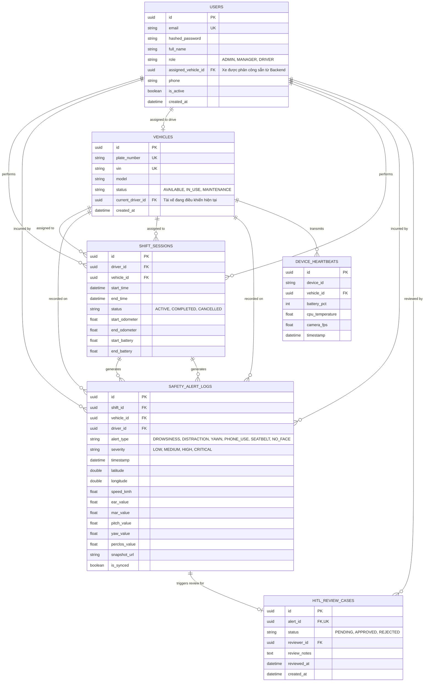

# 🗄️ 02. DATABASE SCHEMA & PERSISTENCE SPECIFICATION
> **Thiết Kế Cơ Sở Dữ Liệu PostgreSQL (Server) & SQLite Outbox (Mobile Edge)**

---

## 1. SƠ ĐỒ THỰC THỂ QUAN HỆ (ERD - POSTGRESQL)



---

## 2. PYTHON SQLALCHEMY 2.0 MODELS MẪU

```python
# src/models/user.py & src/models/vehicle.py
import uuid
from sqlalchemy import Column, String, Boolean, DateTime, ForeignKey
from sqlalchemy.dialects.postgresql import UUID
from sqlalchemy.orm import relationship
from src.database import Base

class User(Base):
    __tablename__ = "users"

    id = Column(UUID(as_uuid=True), primary_key=True, default=uuid.uuid4)
    email = Column(String(255), unique=True, nullable=False, index=True)
    hashed_password = Column(String(255), nullable=False)
    full_name = Column(String(255), nullable=False)
    role = Column(String(50), default="DRIVER")
    phone = Column(String(20), nullable=True)
    is_active = Column(Boolean, default=True)

    # Xe được Quản trị / Điều phối viên phân công trước cho tài xế
    assigned_vehicle_id = Column(UUID(as_uuid=True), ForeignKey("vehicles.id", ondelete="SET NULL"), nullable=True)
    assigned_vehicle = relationship("Vehicle", foreign_keys=[assigned_vehicle_id], back_populates="assigned_driver")

class Vehicle(Base):
    __tablename__ = "vehicles"

    id = Column(UUID(as_uuid=True), primary_key=True, default=uuid.uuid4)
    plate_number = Column(String(20), unique=True, nullable=False, index=True)
    vin = Column(String(50), unique=True, nullable=False)
    model = Column(String(100), nullable=False)
    status = Column(String(50), default="AVAILABLE") # AVAILABLE, IN_USE, MAINTENANCE

    # Tài xế được phân công mặc định
    assigned_driver = relationship("User", foreign_keys=[User.assigned_vehicle_id], back_populates="assigned_vehicle", uselist=False)

# src/models/safety.py
import enum
import uuid
from datetime import datetime
from sqlalchemy import Column, String, DateTime, Float, Boolean, ForeignKey, Enum, Text, Integer
from sqlalchemy.dialects.postgresql import UUID
from sqlalchemy.orm import relationship
from src.database import Base

class AlertSeverity(str, enum.Enum):
    LOW = "LOW"
    MEDIUM = "MEDIUM"
    HIGH = "HIGH"
    CRITICAL = "CRITICAL"

class AlertType(str, enum.Enum):
    DROWSINESS = "DROWSINESS"
    DISTRACTION = "DISTRACTION"
    YAWN = "YAWN"
    PHONE_USE = "PHONE_USE"
    SEATBELT = "SEATBELT"
    NO_FACE = "NO_FACE"

class ReviewStatus(str, enum.Enum):
    PENDING = "PENDING"
    APPROVED = "APPROVED"
    REJECTED = "REJECTED"

class SafetyAlertLog(Base):
    __tablename__ = "safety_alert_logs"

    id = Column(UUID(as_uuid=True), primary_key=True, default=uuid.uuid4)
    shift_id = Column(UUID(as_uuid=True), ForeignKey("shift_sessions.id", ondelete="SET NULL"), nullable=True, index=True)
    vehicle_id = Column(UUID(as_uuid=True), ForeignKey("vehicles.id", ondelete="CASCADE"), nullable=False, index=True)
    driver_id = Column(UUID(as_uuid=True), ForeignKey("users.id", ondelete="SET NULL"), nullable=True, index=True)
    
    alert_type = Column(Enum(AlertType), nullable=False, index=True)
    severity = Column(Enum(AlertSeverity), nullable=False, index=True)
    timestamp = Column(DateTime(timezone=True), default=datetime.utcnow, nullable=False, index=True)
    
    latitude = Column(Float, nullable=True)
    longitude = Column(Float, nullable=True)
    speed_kmh = Column(Float, default=0.0)
    
    # Biometric Telemetry at Trigger Instant
    ear_value = Column(Float, nullable=True)
    mar_value = Column(Float, nullable=True)
    pitch_value = Column(Float, nullable=True)
    yaw_value = Column(Float, nullable=True)
    perclos_value = Column(Float, nullable=True)
    
    snapshot_url = Column(String(500), nullable=True)
    is_synced = Column(Boolean, default=True)

    hitl_case = relationship("HitlReviewCase", back_populates="alert", uselist=False)

class HitlReviewCase(Base):
    __tablename__ = "hitl_review_cases"

    id = Column(UUID(as_uuid=True), primary_key=True, default=uuid.uuid4)
    alert_id = Column(UUID(as_uuid=True), ForeignKey("safety_alert_logs.id", ondelete="CASCADE"), unique=True, nullable=False)
    status = Column(Enum(ReviewStatus), default=ReviewStatus.PENDING, nullable=False, index=True)
    reviewer_id = Column(UUID(as_uuid=True), ForeignKey("users.id", ondelete="SET NULL"), nullable=True)
    review_notes = Column(Text, nullable=True)
    reviewed_at = Column(DateTime(timezone=True), nullable=True)
    created_at = Column(DateTime(timezone=True), default=datetime.utcnow, nullable=False)

    alert = relationship("SafetyAlertLog", back_populates="hitl_case")
```

---

## 3. SQLITE OFFLINE OUTBOX TRÊN ANDROID (EDGE PERSISTENCE)

Trên điện thoại Android, khi xe đi vào hầm, đèo núi hoặc vùng mất sóng 4G, các cảnh báo an toàn được lưu ngay vào bảng SQLite nội bộ máy.

```sql
CREATE TABLE IF NOT EXISTS offline_alerts_outbox (
    local_id INTEGER PRIMARY KEY AUTOINCREMENT,
    event_uuid TEXT NOT NULL UNIQUE,
    topic TEXT NOT NULL,
    payload_json TEXT NOT NULL,
    created_at INTEGER NOT NULL,
    retry_count INTEGER DEFAULT 0,
    status TEXT DEFAULT 'PENDING' -- 'PENDING', 'SENT', 'FAILED'
);

CREATE INDEX IF NOT EXISTS idx_outbox_status ON offline_alerts_outbox(status);
```

### Cơ chế Quét & Đẩy Bù (Outbox Worker Algorithm)
1. Khi có cảnh báo: Lưu bản ghi vào `offline_alerts_outbox` với trạng thái `PENDING`.
2. Nếu MQTT Client đang kết nối:
   - Đẩy gói tin qua MQTT QoS 1.
   - Khi nhận `PUBACK` từ EMQX Broker -> Cập nhật trạng thái thành `SENT` hoặc xóa bản ghi khỏi SQLite.
3. Nếu MQTT ngắt kết nối:
   - Giữ nguyên trong Outbox.
   - Khi hàm `onConnected()` của MQTT callback được kích hoạt -> Khởi chạy một tiến trình nền truy vấn các bản ghi `PENDING`, sắp xếp theo `created_at ASC` và gửi tuần tự lên Broker.

---

## 4. DỮ LIỆU KHỞI TẠO MẪU (SEED DATA)

```python
# src/seed.py
# Tài khoản kiểm thử mặc định:
# 1. Admin: admin@driverguard.ai / Admin@123 (Role: ADMIN)
# 2. Manager: manager@driverguard.ai / Manager@123 (Role: MANAGER)
# 3. Tài xế 1: driver1@driverguard.ai / Driver@123 (Role: DRIVER)
# 4. Tài xế 2: ngatai@driverguard.ai / Driver@123 (Role: DRIVER)

# Danh sách phương tiện kiểm thử:
# - Xe 1: Biển 30G-456.78 | VinFast VF8 | VIN: VF8VN2024001 | Status: AVAILABLE
# - Xe 2: Biển 29E-888.99 | Hyundai SantaFe | VIN: HYUSF2023099 | Status: AVAILABLE
# - Xe 3: Biển 51K-123.45 | Ford Transit | VIN: FORTR2022123 | Status: AVAILABLE
```
