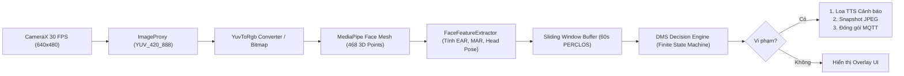

# 🧠 05. EDGE AI & COMPUTER VISION SPECIFICATION
> **Đặc Tả Thuật Toán Thị Giác Máy Tính (MediaPipe Face Mesh), Công Thức Sinh Trắc & Xử Lý Biên Trên Android**

---

## 1. KIẾN TRÚC PIPELINE XỬ LÝ FRAME CAMERA TRÊN ANDROID



---

## 2. CHỈ MỤC CÁC ĐIỂM MỐC KHUÔN MẶT (FACEMESH LANDMARKS)

MediaPipe cung cấp 468 điểm mốc không gian 3 chiều $(X, Y, Z)$ đã được chuẩn hóa trong khoảng $[0.0, 1.0]$:

- **Mắt trái (Left Eye)**:
  - Góc ngoài: `33`, Góc trong: `133`
  - Mí trên: `160`, `158`
  - Mí dưới: `144`, `153`
- **Mắt phải (Right Eye)**:
  - Góc ngoài: `263`, Góc trong: `362`
  - Mí trên: `385`, `387`
  - Mí dưới: `373`, `380`
- **Miệng (Mouth)**:
  - Mép trái: `61`, Mép phải: `291`
  - Môi trên (đỉnh): `13`, Môi dưới (đáy): `14`
  - Điểm môi phụ: `0`, `17`, `78`, `308`
- **Các điểm tham chiếu ước lượng góc đầu (Head Pose PnP)**:
  - Chóp mũi: `1`
  - Cằm: `152`
  - Khóe mắt trái ngoài: `33`
  - Khóe mắt phải ngoài: `263`
  - Khóe môi trái: `61`
  - Khóe môi phải: `291`

---

## 3. CÔNG THỨC TOÁN HỌC & NGƯỠNG KÍCH HOẠT (BIOMETRIC METRICS)

### 3.1 Tỷ Lệ Mở Mắt (EAR - Eye Aspect Ratio)
Công thức tính cho từng bên mắt:
$$\text{EAR} = \frac{||P_{upper1} - P_{lower1}|| + ||P_{upper2} - P_{lower2}||}{2 \times ||P_{corner1} - P_{corner2}||}$$

Giá trị EAR trung bình của tài xế:
$$\text{EAR}_{avg} = \frac{\text{EAR}_{left} + \text{EAR}_{right}}{2}$$

- **Trạng thái bình thường**: $\text{EAR}_{avg} \ge 0.28$
- **Nhắm mắt / Sụp mí**: $\text{EAR}_{avg} < 0.22$
- **Quy tắc phát hiện ngủ gật**: Nếu $\text{EAR}_{avg} < 0.22$ liên tục trong $\ge 2.0$ giây ($\approx 60$ frames ở 30 FPS) $\rightarrow$ Kích hoạt cảnh báo **DROWSINESS** (Ngủ gật).

---

### 3.2 Tỷ Lệ Mở Miệng (MAR - Mouth Aspect Ratio)
Đo độ há miệng để phát hiện ngáp liên tục hoặc mệt mỏi:
$$\text{MAR} = \frac{||P_{13} - P_{14}||}{||P_{61} - P_{291}||}$$

- **Trạng thái bình thường**: $\text{MAR} \le 0.35$
- **Há to / Ngáp**: $\text{MAR} > 0.65$
- **Quy tắc phát hiện ngáp**: Nếu $\text{MAR} > 0.65$ liên tục trong $\ge 1.8$ giây $\rightarrow$ Kích hoạt cảnh báo **YAWN** (Ngáp).

---

### 3.3 Ước Lượng Góc Đầu (Head Pose: Pitch, Yaw, Roll)
Sử dụng thuật toán **Perspective-n-Point (PnP)** với mô hình mặt người chuẩn 3D:
- **Yaw (Quay đầu trái / phải)**:
  - Nếu $|Yaw| > 25^\circ$ liên tục $\ge 2.5$ giây $\rightarrow$ Cảnh báo **DISTRACTION** (Nhìn sang hai bên, không nhìn đường).
- **Pitch (Cúi đầu / Ngửa đầu)**:
  - Nếu $Pitch < -15^\circ$ liên tục $\ge 2.5$ giây $\rightarrow$ Cảnh báo **DISTRACTION** (Cúi mặt nhìn điện thoại hoặc gục đầu vô thức).

---

### 3.4 Chỉ Số Buồn Ngủ Tích Lũy (PERCLOS)
Tỷ lệ phần trăm thời gian mắt nhắm từ $80\%$ trở lên trong cửa sổ trượt 60 giây gần nhất:
$$\text{PERCLOS} = \frac{\sum_{i=1}^{N} \mathbb{I}(\text{EAR}_i < \text{EAR}_{threshold})}{N}$$
- Nếu $\text{PERCLOS} > 0.35$ (Mắt nhắm hơn 35% thời gian trong 1 phút qua) $\rightarrow$ Đánh giá mức độ rủi ro là **CRITICAL**.

---

## 4. BỘ MÁY TRẠNG THÁI RA QUYẾT ĐỊNH (FINITE STATE MACHINE - FSM)

Để tránh hiện tượng còi báo động kêu liên tục không ngừng gây ức chế tài xế (Alarm Fatigue):

```
[NORMAL] ---> (Điều kiện vi phạm kéo dài) ---> [WARNING]
   ^                                               |
   |                                               v
[COOLDOWN (3s)] <--- (Phát còi báo động) <--- [ALERT_TRIGGERED]
```

1. **NORMAL**: Chỉ số bình thường, màn hình viền xanh lá.
2. **WARNING**: Nhắm mắt từ 1.0s đến 1.9s, viền màn hình chuyển sang màu vàng nhấp nháy.
3. **ALERT_TRIGGERED**: Nhắm mắt vượt quá 2.0s:
   - Phát âm thanh cảnh báo / Giọng đọc tiếng Việt (TTS).
   - Chụp ảnh bằng chứng.
   - Gửi sự kiện MQTT lên hệ thống.
4. **COOLDOWN**: Sau khi vừa phát còi, thiết bị tạm ngưng phát chuông tiếp trong 3 giây để tài xế có thời gian mở mắt hoàn hồn.

---

## 5. BÀI HỌC CỐT TỬ: GPS FALLBACK KHI TEST INDOORS (TRÁNH LỖI MẤT CẢNH BÁO)

### Vấn đề thực tế
Khi lập trình viên hoặc sinh viên test hệ thống trong nhà (phòng Lab, phòng làm việc), điện thoại **không bắt được sóng vệ tinh GPS**, dẫn đến đối tượng `Location` bị `null`.  
Nếu viết như sau:
```java
// SAI LẦM: Làm mất sạch cảnh báo khi test trong nhà!
Location loc = locationManager.getLastKnownLocation(...);
if (loc == null) {
    Log.e("DMS", "No GPS fix, dropping alert!");
    return; // Cảnh báo bị hủy, server không bao giờ nhận được!
}
```

### Giải pháp chuẩn công nghiệp
Luôn luôn cung cấp cơ chế Fallback Location:
```java
// CHUẨN XÁC: Đảm bảo cảnh báo an toàn luôn được phát đi
public Location getSafeLocation() {
    Location loc = getCurrentGpsLocation();
    if (loc != null) {
        return loc;
    }
    
    // Fallback 1: Lấy Last Known Location từ Network Provider
    loc = locationManager.getLastKnownLocation(LocationManager.NETWORK_PROVIDER);
    if (loc != null) {
        return loc;
    }
    
    // Fallback 2: Trả về tọa độ mặc định để không làm mất gói tin
    Location mockLoc = new Location("fallback_provider");
    mockLoc.setLatitude(21.028511);  // Hà Nội
    mockLoc.setLongitude(105.854444);
    mockLoc.setSpeed(0.0f);
    mockLoc.setTime(System.currentTimeMillis());
    return mockLoc;
}
```
